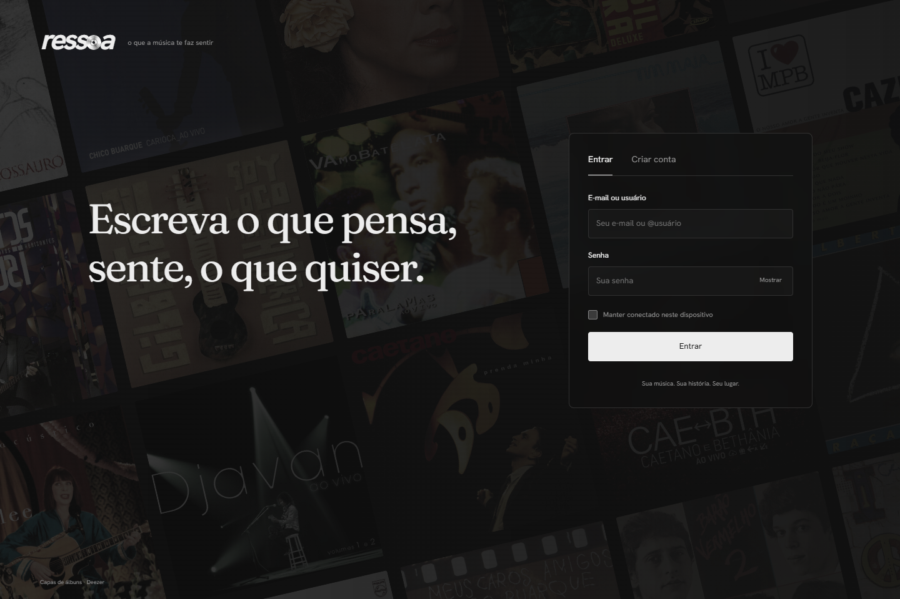

<div align="center">

# Ressoa

**o que a música te faz sentir**

Um diário musical para guardar lembranças, compartilhar sentimentos e descobrir pessoas através da música.

[Acessar o Ressoa](https://ressoa.onrender.com) · [Funcionalidades](#funcionalidades) · [Tecnologias](#tecnologias) · [Rodar localmente](#rodar-localmente)

</div>

[](https://ressoa.onrender.com)

## Sobre o projeto

O Ressoa nasceu da ideia de que uma música pode dizer muito sobre um momento. Cada publicação, chamada de **Ressoa**, reúne uma faixa e aquilo que ela representa para quem está ouvindo: um comentário, uma lembrança ou um trecho da letra.

O site combina um diário pessoal com uma rede social. Você pode guardar suas músicas, acompanhar outras pessoas e escolher uma faixa para representar a semana. A interface usa tema escuro, capas de álbuns e uma identidade inspirada em discos, dando espaço para a música e para o texto de cada pessoa.

O projeto está disponível em **[ressoa.onrender.com](https://ressoa.onrender.com)**. Para publicar, interagir e acessar os perfis, é necessário criar uma conta.

## Funcionalidades

- **For you:** navegação entre Ressoas, prévias de áudio sobre as capas e prioridade para pessoas que você segue. Publicações comuns aparecem no feed por 24 horas e continuam disponíveis no perfil.
- **Meus sons:** diário em blocos, com criação, edição, exclusão e controle de visibilidade das publicações.
- **Ressoa da semana:** uma escolha por semana, independente do diário e em destaque no feed e no perfil.
- **Músicas e letras:** busca de faixas, capas, metadados, prévias e seleção de um trecho da letra para compor a publicação, conforme disponibilidade.
- **Perfil:** foto, bio, até seis músicas favoritas, publicações fixadas, reposts e capa de fundo personalizável.
- **Conexões:** busca de pessoas, seguidores, contas privadas e aprovação de solicitações para seguir.
- **Interações:** curtidas sem contagem pública, reposts e Ressoas salvos. O autor pode consultar quem curtiu ou repostou.
- **Compartilhamento:** prévia da imagem, download do Ressoa e cópia do link. Após entrar ou criar uma conta pelo link, a pessoa chega à publicação compartilhada.
- **Contas:** cadastro, login por e-mail ou usuário e opção de manter a sessão no dispositivo.

## Tecnologias

| Parte | Implementação |
| --- | --- |
| Interface | HTML, CSS responsivo e JavaScript com módulos ES |
| Backend | Python e API HTTP sobre WSGI |
| Banco local | SQLite |
| Banco de produção | PostgreSQL no Neon, com Psycopg |
| Servidor | Gunicorn em contêiner Docker, hospedado no Render |
| Música | Catálogo e prévias Deezer, embeds Spotify e letras via LRCLIB |
| Testes | unittest e Playwright com Chrome |

### Como funciona

O navegador carrega a interface e conversa com a API Python na mesma origem. O backend cuida do cadastro, das sessões, das regras de publicação e das permissões de acesso aos perfis. As consultas aos serviços de música também passam pelo servidor.

Contas, publicações, favoritas, seguidores e interações ficam no banco. O desenvolvimento usa SQLite; a versão hospedada usa PostgreSQL no Neon. As regras do aplicativo são compartilhadas entre os dois bancos.

As senhas são armazenadas com PBKDF2-SHA256. As sessões usam cookies HttpOnly e SameSite, com Secure em produção. Privacidade, autoria das publicações e o limite semanal são verificados pelo backend. Edições e interações são gravadas em transações; o controle de versão evita que uma aba antiga sobrescreva uma alteração mais recente.

### Estrutura

```text
ressoa/
├── web/                    # Interface, módulos JavaScript, estilos e assets
├── docs/                   # Documentação e imagens do projeto
├── scripts/                # Verificação, backup e manutenção do catálogo
├── tests/                  # Testes de API e regras do aplicativo
├── webapp.py               # Aplicação WSGI e rotas HTTP
├── database.py             # Persistência e regras de negócio
├── postgres_storage.py     # Adaptação das consultas para PostgreSQL
├── services.py             # Integrações musicais
├── serve.py                # Servidor de desenvolvimento
├── Dockerfile              # Imagem da aplicação
├── gunicorn.conf.py        # Configuração do servidor de produção
└── render.yaml             # Configuração de hospedagem
```


## Testes

A suíte de API usa bancos temporários e cobre autenticação, persistência, privacidade, seguidores, edições, interações e o destaque semanal:

```sh
python -m unittest discover -s tests -v
```

Para verificar também a interface, é necessário ter Chrome instalado e preparar as ferramentas:

```sh
python -m pip install --target .tools playwright pillow "psycopg[binary]==3.3.6"
python scripts/verify.py
```

A verificação completa reúne **45 testes de API e sete suítes de navegador**, com fluxos em desktop e celular. O projeto também inclui um runner para testar com PostgreSQL descartável no Windows:

```sh
python tests/prepare_postgres.py
python scripts/verify_postgres.py --api-only
```

Os relatórios e as capturas ficam em `verification/`.

## Hospedagem e documentação

A versão online roda no **Render**, com os dados no **Neon**. O GitHub guarda o código; bancos locais, backups e credenciais ficam fora do repositório. Como a hospedagem atual usa o plano gratuito do Render, a abertura pode demorar após um período sem acessos.

- [Configuração e manutenção da hospedagem](docs/DEPLOY.md)
- [Catálogo musical, áudio, letras e compartilhamento](docs/CATALOG.md)

Recuperação de senha por e-mail e ferramentas de moderação ainda não estão implementadas.
