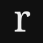
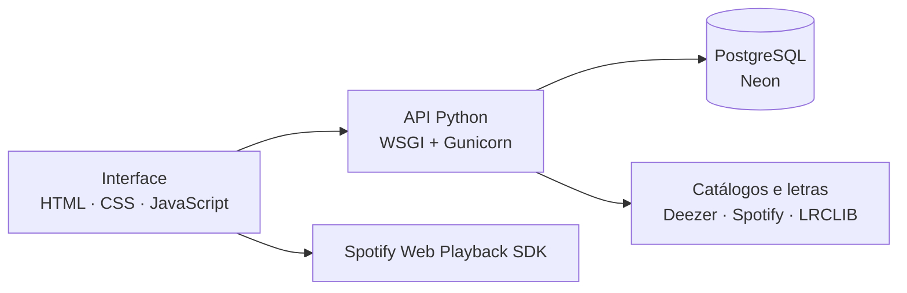

<div align="center">



# Ressoa

**o que a música te faz sentir**

Um diário musical para guardar lembranças, compartilhar sentimentos e descobrir pessoas através da música.

**[Acessar o site](https://ressoa.onrender.com)**

[Funcionalidades](#funcionalidades) · [Tecnologias](#tecnologias) · [Executar localmente](#executar-localmente) · [Deploy](#deploy) · [Próximos passos](#próximos-passos)

</div>

---

## Sobre

Uma música pode marcar uma fase, trazer alguém de volta à memória ou simplesmente traduzir o dia. O Ressoa nasceu para guardar esses momentos.

Cada publicação reúne uma faixa e o que você quiser acrescentar: um pensamento, uma lembrança ou alguns versos. Também é possível deixar apenas a música falar. O diário convive com um feed social, perfis personalizáveis e uma escolha musical para representar a semana.

A interface usa tema escuro, capas de álbuns e elementos inspirados em discos. O foco está na música e no que cada pessoa escreve.

**A primeira versão está no ar:** [ressoa.onrender.com](https://ressoa.onrender.com). O acesso às publicações e aos perfis acontece após o login.

## Funcionalidades

| Recurso | O que você pode fazer |
| --- | --- |
| **For you e Seguindo** | Descobrir Ressoas ou acompanhar apenas quem você segue, com navegação vertical por toque, mouse e teclado. |
| **Meus sons** | Organizar o diário em blocos, criar, editar, apagar e escolher a visibilidade das publicações. |
| **Ressoa da semana** | Escolher uma música por semana, com destaque no feed e no perfil, independente do diário. |
| **Perfil** | Personalizar foto, bio e fundo; escolher até seis favoritas; fixar publicações e reunir seus Ressoas e reposts. |
| **Conexões** | Buscar pessoas, seguir perfis e aprovar solicitações quando sua conta for privada. |
| **Interações** | Curtir sem contagem pública, comentar, repostar e salvar publicações. O autor pode consultar curtidas e reposts. |
| **Notificações** | Acompanhar novos seguidores, solicitações, curtidas, reposts e comentários no mesmo lugar. |
| **Compartilhamento** | Visualizar e baixar a imagem do Ressoa ou copiar seu link. Depois do login, o link leva à publicação compartilhada. |

O feed trabalha com grupos de até dez publicações, priorizando as recentes e ainda não vistas. Ressoas comuns permanecem no feed por 24 horas e continuam disponíveis no perfil e no diário.

Contas privadas permitem controlar quem vê suas publicações. As permissões de acesso, a autoria das alterações e o limite do Ressoa da semana são conferidos no servidor.

### Música, áudio e letra

- **Busca por música, artista ou link:** catálogo Deezer e, com a conta conectada, busca oficial do Spotify.
- **Áudio sobre a capa:** ouvir a prévia de uma faixa ou o trecho escolhido para a publicação.
- **Seleção de até 30 segundos:** arrastar a janela pela música, com play/pausa, marcador de reprodução e relógio.
- **Versos na publicação:** escolher algumas linhas da letra para aparecerem sobre a capa esmaecida.
- **Áudio e letra alinhados:** quando existem horários dos versos, a seleção pode acompanhar o trecho de áudio; a edição manual continua disponível.

A escolha de qualquer ponto da faixa usa o Spotify conectado; cada ouvinte precisa da própria conta Premium para reproduzir esse áudio. As prévias Deezer funcionam sem conectar uma conta externa. Capas, letras e áudio dependem da disponibilidade de cada gravação.

Conectar a conta, buscar uma música ou navegar pelo feed não inicia o player Spotify. A reprodução da faixa completa usa o Spotify Connect no dispositivo criado pelo navegador do Ressoa; por isso, pode aparecer também no aplicativo Spotify. O aplicativo não precisa estar aberto. Quando a faixa já está carregada no player do navegador, a reprodução é retomada por ele, sem reenviar a ordem de carregamento pela API.

## Tecnologias

| Camada | Implementação |
| --- | --- |
| **Frontend** | HTML, CSS responsivo e JavaScript com módulos ES, sem framework |
| **Backend** | Python, aplicação WSGI e API HTTP na mesma origem da interface |
| **Desenvolvimento** | SQLite e servidor local em Python |
| **Persistência em produção** | PostgreSQL no Neon, com Psycopg e pool de conexões |
| **Servidor e hospedagem** | Gunicorn em contêiner Docker no Render |
| **Integrações** | Deezer, Spotify Web API, Spotify Web Playback SDK e LRCLIB |

### Arquitetura



O backend concentra as regras de negócio e o acesso ao banco. Contas, publicações, favoritas, seguidores e interações ficam persistidos no servidor. Em desenvolvimento, o SQLite ocupa o lugar do PostgreSQL sem mudar as regras da aplicação.

As senhas são armazenadas com PBKDF2-SHA256. As sessões usam cookies HttpOnly e SameSite, com Secure em produção. Gravações usam transações, e o controle de versão impede que uma aba desatualizada sobrescreva alterações mais recentes.

A conexão Spotify usa OAuth com PKCE, sem Client Secret. O token de renovação permanece no servidor; o navegador recebe apenas o acesso necessário ao player da própria conta. O Ressoa não baixa nem armazena arquivos de áudio das músicas.

### Estrutura do projeto

```text
ressoa/
├── web/                    # Páginas, estilos, módulos JavaScript e assets
├── webapp.py               # Aplicação WSGI e rotas HTTP
├── database.py             # Persistência e regras de negócio
├── postgres_storage.py     # Adaptação e conexões com PostgreSQL
├── services.py             # Catálogos musicais, metadados e letras
├── spotify.py              # Autorização, busca e reprodução pelo Spotify
├── mail.py                 # Infraestrutura de recuperação de senha por e-mail
├── serve.py                # Servidor de desenvolvimento
├── requirements.txt        # Dependências Python
├── Dockerfile              # Imagem da aplicação
├── gunicorn.conf.py        # Servidor de produção
├── render.yaml             # Configuração do serviço no Render
└── .env.example            # Referência das variáveis de ambiente
```

## Executar localmente

Com o repositório clonado e o **Python 3.14** instalado, execute na pasta do projeto:

```powershell
python -m venv .venv
.\.venv\Scripts\python.exe -m pip install -r requirements.txt
.\.venv\Scripts\python.exe serve.py
```

Abra **[localhost:8000](http://localhost:8000)**. No Linux ou macOS, use `.venv/bin/python` no lugar de `.\.venv\Scripts\python.exe`.

O banco SQLite é criado automaticamente em `storage/ressoa.sqlite3`, sem contas ou publicações de exemplo. O ambiente local não precisa do banco de produção.

O arquivo [`.env.example`](.env.example) serve como referência e não é carregado automaticamente. Variáveis opcionais devem ser definidas no terminal antes de iniciar o servidor.

## Deploy

O **GitHub** guarda o código, o **Render** executa a aplicação e o **Neon** mantém o banco PostgreSQL. A publicação usa o [Dockerfile](Dockerfile), com a configuração de serviço em [render.yaml](render.yaml).

| Variável | Uso |
| --- | --- |
| `RESSOA_ENV` | `production` no ambiente hospedado |
| `DATABASE_URL` | Conexão privada com o PostgreSQL do Neon |
| `APP_ORIGIN` | Endereço HTTPS público; inferido do Render quando não definido |
| `SPOTIFY_CLIENT_ID` | Habilita a conexão opcional com o aplicativo Spotify |
| `GOOGLE_SITE_VERIFICATION` | Identificação opcional do site no Google Search Console |

As credenciais são configuradas no painel do Render. O banco local, senhas e chaves privadas ficam fora do Git.

Atualizações enviadas à branch `main` acionam o deploy automático do serviço conectado. O contêiner pode ser substituído sem apagar as contas e publicações, que permanecem no Neon. Uma instalação com banco vazio cria somente a estrutura necessária, sem dados de demonstração.

- **`/healthz`:** verifica se o servidor está respondendo; usado pelo Render.
- **`/readyz`:** verifica também a conexão com o banco; útil para diagnóstico.

O plano gratuito do Render pode suspender a aplicação após períodos sem acesso, aumentando o tempo da primeira abertura.

<details>
<summary><strong>Configurar a conexão com Spotify</strong></summary>

1. Crie um aplicativo no [Spotify for Developers](https://developer.spotify.com/dashboard) com **Web API** e **Web Playback SDK**.
2. Cadastre o endereço do site e a URI de retorno exata: `https://ressoa.onrender.com/api/spotify/callback`.
3. Configure `SPOTIFY_CLIENT_ID` no Render e publique a aplicação.
4. No Ressoa, use **Conectar Spotify**, pelo ícone ao lado da busca ou pelo seletor de músicas. Com a conta conectada, a opção passa a ser **Desconectar Spotify**.

A reprodução pelo SDK exige Spotify Premium. Aplicativos em desenvolvimento têm limites de usuários autorizados; ampliar o acesso depende das [regras do Spotify](https://developer.spotify.com/documentation/web-api/concepts/quota-modes).

Em um aplicativo novo no modo de desenvolvimento, são permitidas até **cinco contas Spotify autorizadas**. No Dashboard, abra **Settings → Users Management → Add new user** e informe o nome e o e-mail usado no Spotify de cada pessoa de teste. Criar uma conta no Ressoa não inclui essa pessoa na lista do Spotify. Uma conta não autorizada pode fazer login no Spotify e ainda receber erro 403 ao concluir a conexão.

A conexão fica vinculada à conta Ressoa no banco, podendo ser recuperada em outro dispositivo. Ao retornar da autorização no celular, o site também consulta a confirmação no servidor, sem depender apenas da comunicação entre abas. Se o navegador perder a referência à aba original, a página de retorno leva ao início do Ressoa. Contas sem Premium podem concluir a conexão para o catálogo quando autorizadas pelo Spotify; a exigência de Premium continua sendo verificada na reprodução.

Alguns navegadores móveis exigem um toque no play para liberar o áudio. Desconectar o Spotify remove essa conexão, preservando a conta e as publicações no Ressoa. Se o domínio do site mudar, atualize também a URI de retorno no painel do Spotify.

</details>

## Próximos passos

- [ ] Concluir a ativação e a validação do envio de e-mails para recuperação de senha.
- [ ] Implementar a confirmação de e-mail no cadastro.
- [ ] Adicionar ferramentas de denúncia e moderação de conteúdo.
- [ ] Ampliar a validação de acessibilidade e de reprodução nos navegadores móveis.

---

Desenvolvido por [pedrolucas-pf](https://github.com/pedrolucas-pf).
